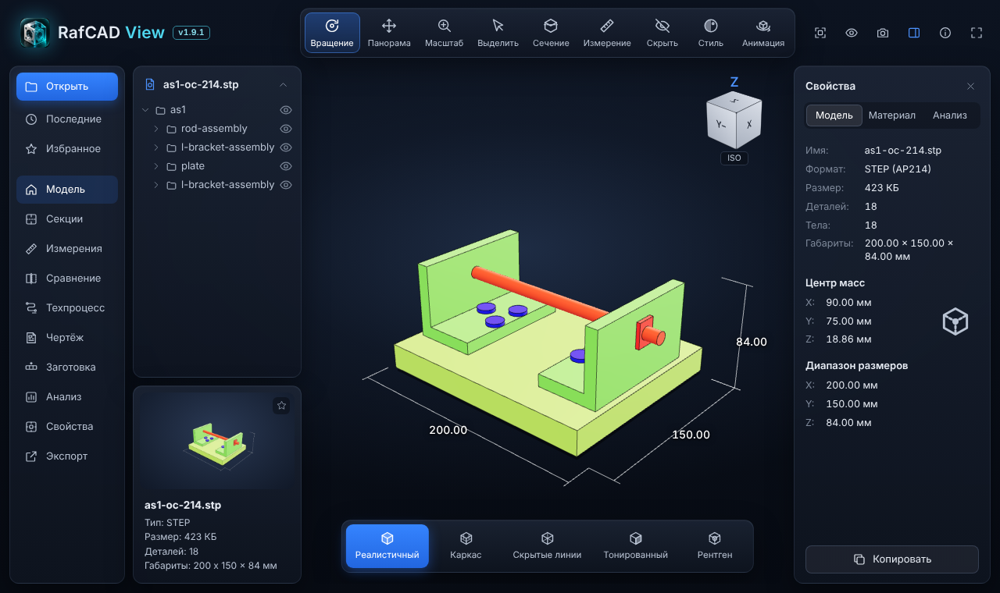
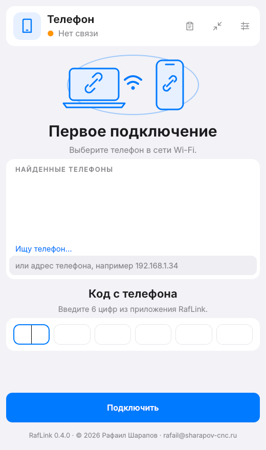
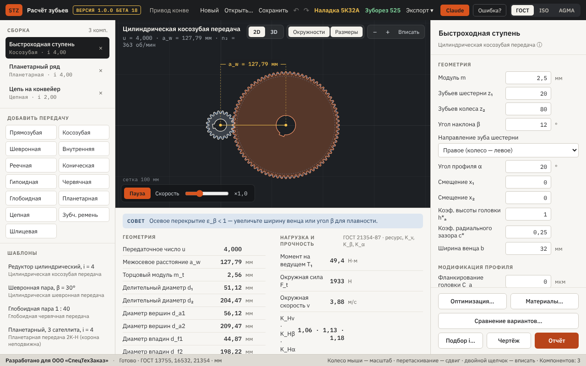
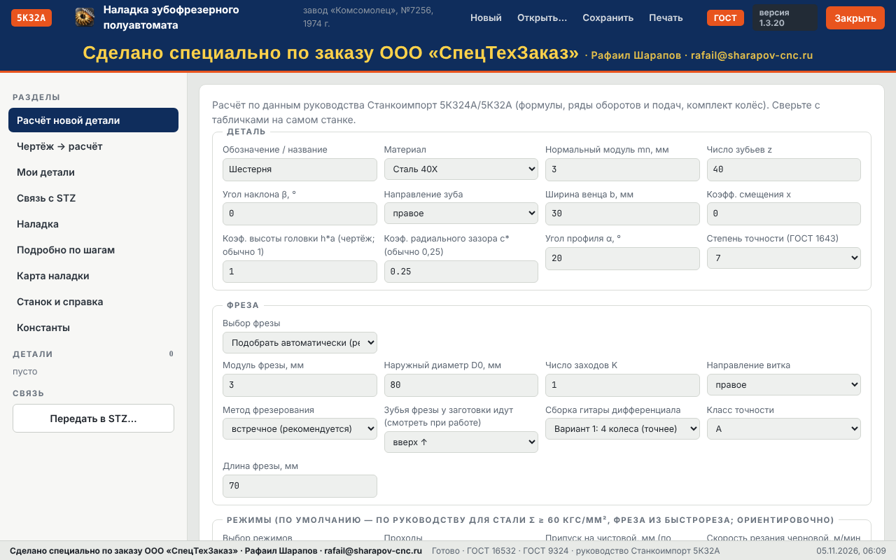
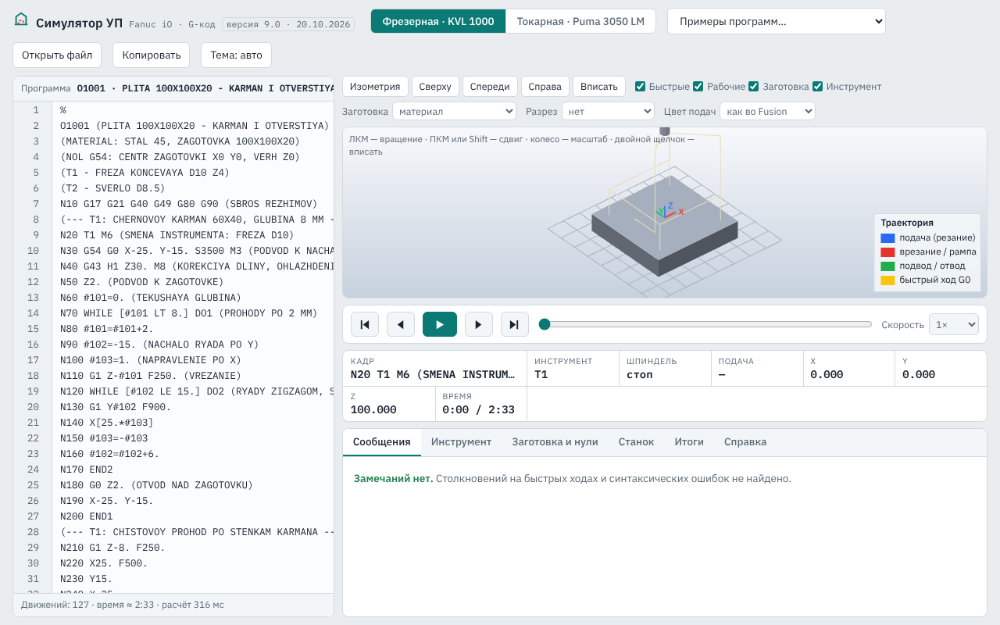
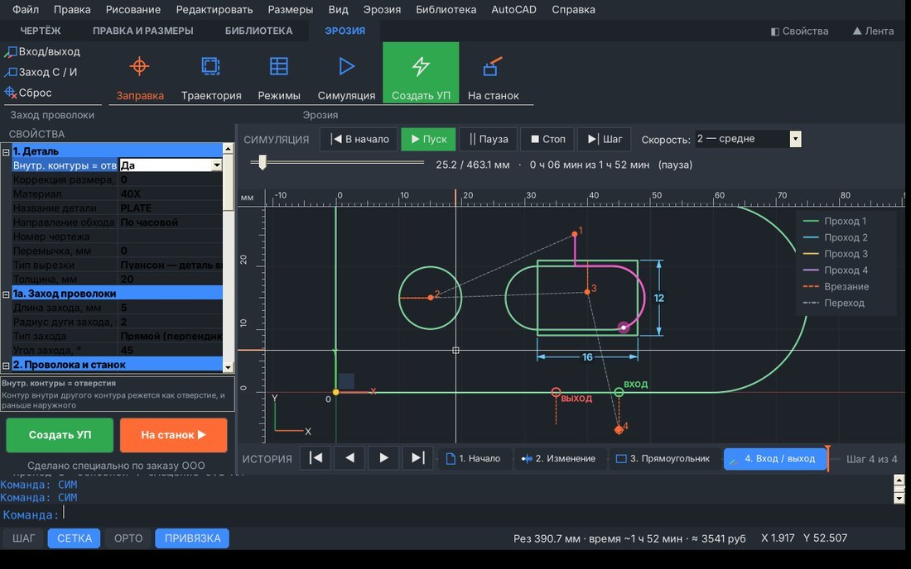

# Программы для цеха ЧПУ · Software for CNC shops

**RafCAD View** — быстрый просмотр STEP/STL/DXF/DWG · **RafLink** — телефон ↔ ПК по Wi-Fi

**STZ** — расчёт зубчатых передач, наладка 5К32А и 525, симулятор УП Fanuc, передача УП на станок

Бесплатно · без облаков и подписок · на русском · Windows, Mac, Android, iPhone

Автор: **Рафаил Шарапов**, разработчик управляющих программ для станков ЧПУ · ✉ rafail@sharapov-cnc.ru

⭐ Если программы пригодились — поставьте звезду, это помогает другим их найти.

---

## 🧊 RafCAD View — просмотрщик 3D-моделей и чертежей

Открывает **STEP/STP, IGES, BREP, STL, OBJ, 3MF, GLB, DXF, DWG** за секунды, без интернета и без лицензий.

- Дерево сборки, сечение, измерения, габариты, центр масс, режимы отображения.
- **Эскизы моделей в Проводнике Windows** — вместо значков картинка детали.
- **Ведомость заготовок / карта нарезки**: круг, квадрат, шестигранник, труба, лист; масса, хлысты, пропил.
- **Чертёж** нескольких моделей одним PDF, техпроцесс, экспорт.

**Скачать:** [Releases](https://github.com/sharapovrafail-bot/modelview/releases) — Windows `RafCADView-Setup-*.exe`,
Mac — [mac-latest](https://github.com/sharapovrafail-bot/modelview/releases/tag/mac-latest) (Apple M и Intel).
Подробно: [docs/RafCADView.md](docs/RafCADView.md).

---

## 📱 RafLink — телефон Android ↔ ПК по Wi-Fi

Окно телефона на компьютере: папки и фото телефона видны на ПК, файлы **перетаскиваются мышкой** туда и обратно.
С телефона — «Поделиться → На ПК (RafLink)» из любого приложения.
Интернет и облако не нужны — только общая сеть Wi-Fi. Подключение по 6-значному коду.

**Скачать:** [Releases → raflink-latest](https://github.com/sharapovrafail-bot/modelview/releases/tag/raflink-latest)
— `RafLink-Setup-*.exe` на ПК и `RafLink-*.apk` на телефон.
Подробно: [raflink/README.md](raflink/README.md).

 

---

## 🛠 Ещё программы автора — STZ (репозиторий [stz-soft](https://github.com/sharapovrafail-bot/stz-soft))

Бесплатно, без лицензий и ключей. Windows и Mac.

| Программа | Что делает |
|---|---|
| **STZ Расчёт зубьев** | расчёт зубчатых (в т.ч. гипоидных), червячных, цепных, ремённых и шлицевых передач |
| ↳ **Зубофреза 5К32А** | наладка зубофрезерного 5К32А: гитары, фреза, режимы, карта наладки |
| ↳ **Зуборез 525** | наладка зуборезного 525: конические и гипоидные колёса с круговым зубом |
| **Симулятор УП Fanuc** | проверка УП для KVL 1000 (Fanuc 0i-MF) и PUMA 3050 до запуска на станке |
| **STZ FANUC LAN** | передача УП на стойки Fanuc по сети (FOCAS) и RS-232 |
| **STZ WireCut** | программы для проволочно-вырезного электроэрозионного станка |

<table>
<tr>
<td width="50%"><b>STZ Расчёт зубьев</b> </td>
<td width="50%"><b>Наладка зубофрезерного 5К32А</b> </td>
</tr>
<tr>
<td><b>Симулятор УП Fanuc (KVL 1000 / PUMA 3050)</b> </td>
<td><b>STZ WireCut — электроэрозия</b> </td>
</tr>
</table>

**Скачать:** [stz-soft → Releases](https://github.com/sharapovrafail-bot/stz-soft/releases/latest)

---

## Вопросы и предложения

Пишите на **rafail@sharapov-cnc.ru** или в [Issues](https://github.com/sharapovrafail-bot/modelview/issues).
Программы делаются для реального производства — замечания из цеха приветствуются.

Keywords: CNC, ЧПУ, STEP viewer, STL viewer, DXF viewer, DWG viewer,
CAD viewer, Fusion 360, SolidWorks, Fanuc, G-code, file transfer phone to PC.
