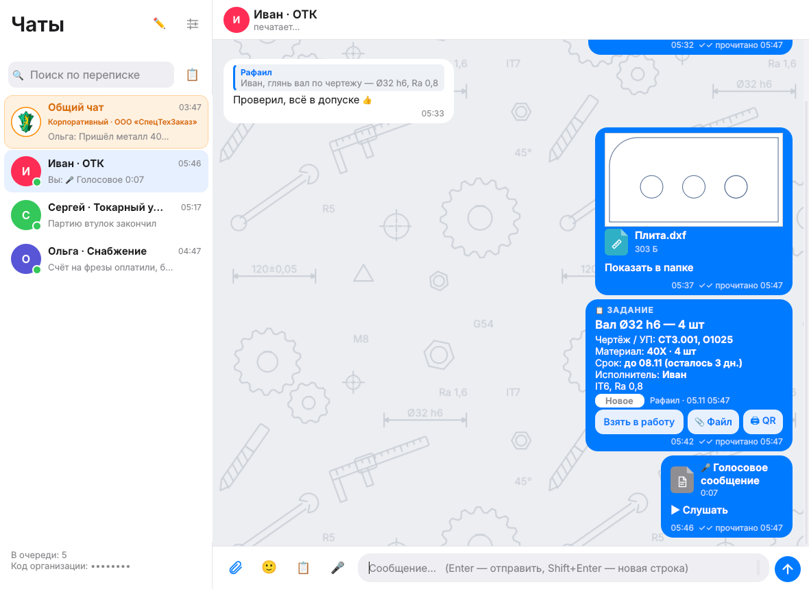
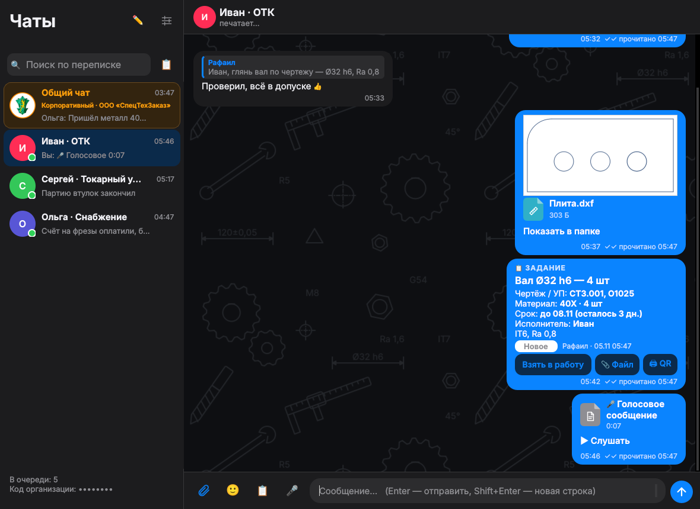

# Программы для цеха ЧПУ · Software for CNC shops

**RafChat** — рабочий чат и файлы для цеха · **RafCAD View** — быстрый просмотр STEP/STL/DXF/DWG · **RafLink** — телефон ↔ ПК по Wi-Fi

Бесплатно · без облаков и подписок · на русском · Windows, Mac, Android, iPhone

Автор: **Рафаил Шарапов**, разработчик управляющих программ для станков ЧПУ · ✉ rafail@sharapov-cnc.ru

⭐ Если программы пригодились — поставьте звезду, это помогает другим их найти.

---

## 💬 RafChat — чат для цеха и офиса

Как WhatsApp, только свой: переписка и файлы идут **напрямую по локальной сети** организации,
а вне офиса — через **ваш собственный сервер** с шифрованием. Никаких чужих облаков.

- **Карточки заданий для цеха**: деталь, чертёж/УП, материал, количество, срок, исполнитель;
  статусы «Новое → В работе → Готово → Принято ОТК / Доработка» кнопками прямо на карточке.
- **Лист задания с QR-кодом** — распечатать и положить к детали; телефон по QR открывает задание.
- **Чертежи и модели прямо в переписке**: PDF, DXF, STL — миниатюрой; у STEP — название детали и CAD.
- **Файлы любого размера** по сети (УП, модели, фото), докачка при обрыве.
- **Голосовые сообщения**, фото с камеры, смайлики, ответы с цитатой, пересылка, поиск по переписке.
- **«печатает…»** и **«✓✓ прочитано 14:05»**, напоминания о сроке задания, **отчёт по заданиям в Excel**.
- Один человек — **один чат на всех его устройствах** (ПК, телефон).
- **Внешние контакты** (заказчики, поставщики) по личному коду — без доступа к общему чату.
- **Тёмная тема**, автообновление.

Тёмная тема

**Скачать:** [Releases → rafchat-latest](https://github.com/sharapovrafail-bot/modelview/releases/tag/rafchat-latest)
— Windows (`.exe`), Android (`.apk`), Mac (`.dmg`), iPhone (`.ipa` через Sideloadly).
Подробно: [rafchat/README.md](rafchat/README.md).

---

## 🧊 RafCAD View — просмотрщик 3D-моделей и чертежей

Открывает **STEP/STP, IGES, BREP, STL, OBJ, 3MF, GLB, DXF, DWG** за секунды, без интернета и без лицензий.

- Дерево сборки, сечение, измерения, габариты, центр масс, режимы отображения.
- **Эскизы моделей в Проводнике Windows** — вместо значков картинка детали.
- **Ведомость заготовок / карта нарезки**: круг, квадрат, шестигранник, труба, лист; масса, хлысты, пропил.
- **Чертёж** нескольких моделей одним PDF, техпроцесс, экспорт.

**Скачать:** [Releases](https://github.com/sharapovrafail-bot/modelview/releases) — Windows `RafCADView-Setup-*.exe`,
Mac — [mac-latest](https://github.com/sharapovrafail-bot/modelview/releases/tag/mac-latest) (Apple M и Intel).
Подробно: [docs/RafCADView.md](docs/RafCADView.md).

---

## 📱 RafLink — телефон Android ↔ ПК по Wi-Fi

Окно телефона на компьютере: папки и фото телефона видны на ПК, файлы **перетаскиваются мышкой** туда и обратно.
С телефона — «Поделиться → На ПК (RafLink)» из любого приложения.
Интернет и облако не нужны — только общая сеть Wi-Fi. Подключение по 6-значному коду.

**Скачать:** [Releases → raflink-latest](https://github.com/sharapovrafail-bot/modelview/releases/tag/raflink-latest)
— `RafLink-Setup-*.exe` на ПК и `RafLink-*.apk` на телефон.
Подробно: [raflink/README.md](raflink/README.md).

 

---

## Вопросы и предложения

Пишите на **rafail@sharapov-cnc.ru** или в [Issues](https://github.com/sharapovrafail-bot/modelview/issues).
Программы делаются для реального производства — замечания из цеха приветствуются.

Keywords: CNC, ЧПУ, chat for manufacturing, shop floor messenger, LAN chat, STEP viewer, STL viewer, DXF viewer, DWG viewer,
CAD viewer, Fusion 360, SolidWorks, Fanuc, G-code, file transfer phone to PC.
